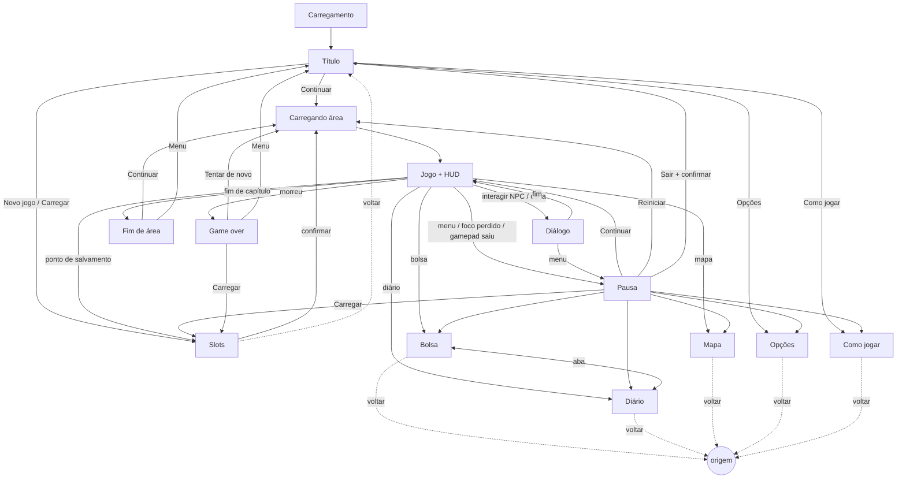

# Inventário de telas, fluxos e HUD — vertical slice (v0.2, direção do protótipo)

> **Dono:** 07 Cenários e UI · **Versão:** v0.2 (BRF-011 / D-024) · **Data:** 2026-10-24 · substitui a v0.1 (BRF-005).
> **Alvo visual:** HUD e menus de **madeira escura + moldura dourada** do protótipo "Vale de Dunwick" (`referencia/prototipo/index.html`, funções `drawPanel`, `bar`, `drawAbilityIcon`, `drawMinimap`, `drawHUD`, `drawDialog`, `bigButton`, `titleText`), **mais polido** e dentro das regras do projeto. Sem arte e sem stack neste documento; ferramenta é do 08, paleta e estilo do 10.
> Controles e acessibilidade: [controles_acessibilidade.md](controles_acessibilidade.md). Kit de cenário: [../cenarios/kit_isometrico.md](../cenarios/kit_isometrico.md).

## 0. O que mudou em relação à v0.1

| Tema | v0.1 (esqueleto cinza) | v0.2 (protótipo, mais polido) |
|---|---|---|
| Resolução da UI | grade de 8 px sobre arte de 640×360 | **1280×720 lógicos**, margem segura 24 px; escala inteira ou fracionária pelo "tamanho da UI" (a UI não é pixel art; o protótipo usa gradiente, serifa e vetor) |
| Visual | pixel art, moldura "original" genérica | painéis de **madeira escura com moldura de ouro**, cantos de latão (losango), retrato circular, ícones redondos, minimapa redondo com borda de ouro, diálogo em **pergaminho**, botões **vinho com borda dourada** |
| HUD | cantos, sem retrato | **canto inferior esquerdo:** retrato + vida + fôlego (+XP) + habilidades Q/E + moedas · **superior esquerdo:** painel de missão · **superior direito:** minimapa · **topo-centro:** barra do chefe |
| Mapa e minimapa | fora do slice | **entram** (o protótipo tem minimapa e mapa grande com M) |
| Economia | sem loja, sem moedas | o protótipo tem **moedas, XP/nível e loja** (via diálogo): **a confirmar com o usuário/06** (§8) |
| Menus | teclado e gamepad completos | protótipo é **só mouse/toque** nos menus: **mantemos** navegação por teclado e gamepad e **acrescentamos** foco visível (§2) |
| Save | 3 slots + automático + exportar/importar | protótipo tem 1 save ("Continuar"/"Novo jogo"). **Mantém-se** a regra do projeto (versão, backup, exportar/importar): a tela de slots fica atrás do menu, e o título mostra o atalho do protótipo |

## 1. Regras que valem para todas as telas

| # | Regra |
|---|---|
| R1 | Todo texto vem de tabela por ID (`ui_` interface, `txt_` conteúdo do 02). Nada escrito no código, nada montado por concatenação: variáveis inteiras (`{nome_item}`, `{qtd}`, `{tempo_jogo}`). |
| R2 | Todo elemento com texto reserva **+40 %** de largura sobre o português (o protótipo mede o texto e cresce o painel: manter, com teto e quebra de linha). |
| R3 | Toda tela tem **voltar/cancelar** (teclado, mouse, gamepad), exceto Título, Carregamento e Game over. Confirmação destrutiva abre com foco em "Cancelar". |
| R4 | Margem segura de 24 px; ritmo de 8 px; componentes únicos: painel, botão grande, botão pequeno, barra, ícone redondo, selo de tecla, aba, lista, grade, deslizante, alternância, dica. Estados: normal, foco, pressionado, desativado, erro. |
| R5 | **Foco sempre visível por forma + cor:** anel de ouro duplo com **setas laterais** (◀ ▶) no botão focado, não só mudança de cor (o protótipo só clareia o botão no hover — insuficiente para teclado e daltonismo). |
| R6 | Animação ≤ 150 ms (abrir/fechar painel: fade + 8 px de deslize); com "reduzir movimento": corte seco. Mensagens centrais e cartões de fase seguem a mesma regra. |
| R7 | **Barra de comandos** no rodapé das telas modais, com selos de tecla/botão do último dispositivo usado e da atribuição atual. |
| R8 | Abrir tela a partir do jogo **pausa a simulação**, exceto Diálogo (mundo parado por regra do 03) e HUD. |
| R9 | **Reservas de cor** (guia do 10): magenta `perigo_*` só para aviso de golpe/zona de dano no mundo; nada de UI em magenta. Dourado = moldura/foco/destaque (a UI conta como interativo). **Erro de UI e vida baixa** usam a rampa `alerta_ui` (vermelho-brasa) **com forma + ícone + texto**. |
| R10 | **Vermelho do HUD** (barra de vida, botões vinho) é cor de identidade, não de alerta: o 10 confirma que fica distinto de `perigo_*` e de `alerta_ui` nos 4 modos de visão (§8, pergunta ao 10). |
| R11 | Sons de UI: IDs `ui_` do 05 (§6). |
| R12 | Fonte: serifa legível com acentos do português (o protótipo usa Georgia, fonte do sistema). **Pergunta ao 08:** fonte embarcada/gerada com licença e fallback? Tamanho mínimo 14 px a 1280×720; texto sobre o mundo sempre com **sombra/contorno ou painel** (o protótipo usa sombra de 1,5 px). |

## 2. Telas do slice

"Entradas" = de onde se chega; "Saídas" = para onde se vai; voltar segue R3. Referência ao protótipo entre colchetes.

### 2.1 `ui_tela_carregamento` — Carregamento [protótipo: "Pintando o vale… %"]
- **Propósito:** cobrir a geração dos gráficos e o carregamento de área/save. O protótipo leva ~25 s para gerar tudo: **orçamento e estratégia do 08** (ADR-002); a UI só mostra.
- **Conteúdo:** título do jogo em degradê de ouro, barra dourada, **porcentagem em texto** (`ui_carregando_pct` com `{pct}`), dica rotativa (`ui_dica_*`), e uma ilustração leve (a praça desfocada ao fundo assim que existir).
- **Erros:** `ui_erro_carregar` + `ui_tentar_novamente`. Sem "voltar".

### 2.2 `ui_tela_titulo` — Título [protótipo: título com praça desfocada, "Jogar" e painel de controles]
- **Propósito:** apresentar o jogo e obter o **primeiro gesto** (libera o áudio).
- **Conteúdo:** logotipo (degradê de ouro, serifa), subtítulo (`ui_titulo_sub`), botões `ui_menu_continuar` / `ui_menu_novo_jogo` (ou só `ui_menu_jogar` na 1ª vez), `ui_menu_carregar`, `ui_menu_opcoes`, `ui_menu_como_jogar`; **painel "Controles"** compacto e atual (atribuições remapeadas) — o protótipo mostra sempre; aqui fica recolhível. Aviso curto de fotossensibilidade na 1ª execução.
- **Fundo:** a cena-modelo (praça) desfocada, com ciclo de luz lento (parada com "reduzir movimento").
- **Saídas:** Continuar → Carregamento → Jogo · Novo jogo → Slots(novo) · Carregar → Slots · Opções · Como jogar. Sem "voltar".

### 2.3 `ui_tela_slots` — Slots de save (3 manuais + 1 automático)
- Mantida da v0.1: modos `novo`, `carregar`, `salvar`; cada slot mostra `{nome_area}`, `{objetivo}`, `{tempo_jogo}`, `{data}` e **miniatura do retrato do herói**; exportar/importar; backup; erros `ui_slot_corrompido`, `ui_importar_invalido` (sem exibir conteúdo do arquivo), `ui_aviso_armazenamento_cheio`; confirmações modais.
- **Visual:** cada slot é um painel de madeira com plaquinha dourada (nome); selecionado = anel duplo + setas.
- **Salvar:** só em pontos de salvamento do mundo + automático (D-007); a pausa só carrega.

### 2.4 `ui_tela_opcoes` — Opções
- Abas `ui_aba_video`, `ui_aba_audio`, `ui_aba_controles`, `ui_aba_acessibilidade` (a v0.1 + o botão "Som: sim/não" do protótipo vira o **volume geral** com atalho de mudo no HUD).
- **Vídeo:** perfil de qualidade (Alto/Médio/Baixo), tela cheia, tamanho da UI, **tempo (ciclo dia/noite): automático / dia fixo / noite fixa** (o protótipo alterna com N).
- Mudanças valem na hora; "restaurar padrão" por aba com confirmação; configurações separadas do save.

### 2.5 `ui_tela_como_jogar` — Como jogar
- Lista das ações com **selos de tecla/botão atuais**, 4–6 dicas curtas e miniaturas animadas (combo, giro, investida, rolamento). Repetível; abre do título e da pausa.

### 2.6 `ui_tela_pausa` — Pausa [protótipo: "Pausado", Continuar / Reiniciar fase / Menu]
- Opções: `ui_pausa_continuar`, `ui_pausa_bolsa`, `ui_pausa_diario`, `ui_pausa_mapa`, `ui_pausa_opcoes`, `ui_pausa_como_jogar`, `ui_pausa_carregar`, `ui_pausa_reiniciar` ("voltar ao último ponto"; o protótipo "Reiniciar fase" — **a confirmar** com 03/06 o que significa no slice), `ui_pausa_sair_menu` (confirmação com `{data}` do último salvamento).
- Fundo: o mundo congelado com escurecimento (`rgba(10,8,4,0.6)` no protótipo) e desfoque leve (desligável); mostra sempre `{nome_area}` e o objetivo atual.
- Entradas: tecla de menu; **automática** ao perder foco, trocar de aba, sair da tela cheia (R do navegador) ou, com gamepad, desconexão.

### 2.7 `ui_tela_bolsa` — Bolsa (inventário simples)
- Não existe no protótipo (itens ficam nos efeitos). Mantida do slice (D-007): grade 6×4 de **casas de madeira com moldura dourada**, painel de detalhe (`txt_item_*`), filtros (todos/consumíveis/missão), `ui_inv_usar`, `ui_inv_definir_rapido`, ordenar; itens de missão não usáveis; raridade só se o 06 definir (cor **+ moldura/forma**).
- Entradas: pausa; atalho direto (`bolsa`). Saídas: voltar; trocar aba → Diário.

### 2.8 `ui_tela_diario` — Diário de missões
- O **painel de missão fica sempre no HUD** como no protótipo (§3); esta tela traz o histórico: abas ativas/concluídas, objetivo atual em destaque, passos concluídos com **ícone + texto**, `ui_missoes_acompanhar` (qual aparece no HUD), marca "novo".
- Entradas: pausa; atalho direto (`diario`); toque na notificação de missão nova.

### 2.9 `ui_tela_mapa` — Mapa [protótipo: mapa grande com M]
- **Entra no slice** (mudança: v0.1 o deixava fora). Minimapa ampliado: disco central dourado girado 45° como o do protótipo (alinha com a isometria), **norte indicado**, **névoa de exploração** (revela o já visitado), ícones por **forma + cor** (herói = seta; NPC com missão = losango dourado; NPC comum = círculo azul-claro; baú = quadrado; inimigo = ponto; chefe = ponto pulsante maior; saída = seta na borda; ponto de salvamento = chama), legenda (`ui_mapa_legenda`), nome da área (`txt_map_*_nome`).
- Sem viagem rápida no slice. Fecha com `mapa`, `cancelar` ou `menu`.

### 2.10 `ui_tela_dialogo` — Diálogo [protótipo: pergaminho com rolos, texto digitado, "F ▶", escolhas]
- **Visual:** caixa de **pergaminho** com rolos nas pontas (como o protótipo), moldura de madeira/ouro mais discreta, retrato circular opcional à esquerda (04), plaquinha do nome do falante no canto, seta pulsante "continuar" com o selo da tecla `interagir` (nunca "F" fixo).
- **Regras:** ≤ ~140 caracteres por caixa; texto aparece por letras com velocidade ajustável (lenta/normal/rápida/instantânea); **primeiro aperto completa a linha**, o seguinte avança; escolhas (≤ 4) em botões de madeira acima da caixa, numeradas, com foco visível; falas sussurradas/narração em itálico (o protótipo marca "(baixinho)" e "[ação]": no jogo, estilos por ID `txt_`, nunca por marca no texto); histórico (`ui_dlg_historico`); pular conversa (escolhas nunca são puladas).
- **Posição:** terço inferior, **fora da zona de ação** (§3.1).
- **Loja via diálogo** (ferreiro Hargen Stoll, equivalente à Bruna do protótipo): opções de compra com preço `{preco}` e `ui_loja_sem_moedas`. **A confirmar** (§8).

### 2.11 `ui_tela_game_over` — Derrota [protótipo: tela vinho "Tentar de novo / Menu"]
- Título em degradê de ouro com tinta vinho, dica (`ui_dica_*`), botões `ui_gameover_tentar` (último autosave/ponto — D-007), `ui_gameover_carregar`, `ui_gameover_menu`. Foco inicial em "Tentar de novo". A morte do herói tem animação de 2,6 s antes da tela (protótipo): pulável.

### 2.12 `ui_tela_fim_area` — Vitória/fim de capítulo [protótipo: tela dourada com nível e moedas]
- Cartão de fim: título (`txt_cap_*`), resumo (`{nivel}` e `{moedas}` **se existirem**, §8), botões Continuar / Menu. No slice: fim da Parte 1 e epílogo (D-017/D-019: "Partir/Ficar" com confirmação).

### 2.13 Avisos e modais
| ID | Quando | Ações |
|---|---|---|
| `ui_modal_confirmar` | sobrescrever, apagar, importar, sair, restaurar | Confirmar / Cancelar (foco em Cancelar) |
| `ui_aviso_foco_perdido` | aba/janela sem foco | qualquer entrada → Pausa |
| `ui_aviso_armazenamento_cheio` | falha de escrita | exportar agora / tentar de novo / cancelar |
| `ui_aviso_salvando` | escrita em andamento | ícone no canto, não bloqueia |
| `ui_aviso_gamepad_desconectado` | gamepad sai | abre a Pausa |
| `ui_aviso_conflito_tecla` | remapear em conflito | Trocar / Cancelar |
| `ui_aviso_orientacao` | celular na vertical (pós-slice) | — |

## 3. HUD [protótipo: `drawHUD`]

### 3.1 Zonas (1280×720 lógicos, margem 24 px)

```
+--------------------------------------------------------------+
| [B] PAINEL DE MISSÃO            [F] barra do chefe   [D] MINIMAPA |
|  (sup. esq.)                    (topo-centro)         redondo     |
|                                                       (sup. dir.) |
|                [M] mensagem central (acima da ação)              |
|             ZONA DE AÇÃO = 60 % × 60 % em torno do herói          |
|             (nada de HUD, números nem notificação aqui)          |
|                                                                   |
|       [H] diálogo (terço inferior, pergaminho)                    |
| [A] RETRATO + VIDA + FÔLEGO + XP · [C] Q/E · moedas   [G] salvando|
+--------------------------------------------------------------+
```

**Regra do telegraph (obrigatória):** nenhum elemento do HUD, notificação ou número flutuante é desenhado na **zona de ação**; o **aviso de golpe** (magenta, no chão) é desenhado **por cima** de qualquer HUD que o toque em telas pequenas. A câmera do protótipo mantém o herói no centro, então a zona de ação é fixa no centro da tela.
**Ajuste de proteção:** o **diálogo** e a **mensagem central** do protótipo ficam logo acima do herói em alguns casos (y = H−230 e y = 96): no jogo, descem para o terço inferior/superior fora da zona, e o jogo **não gera inimigos em combate durante diálogos** (03).

### 3.2 Elementos, estado lido e regras

Nomes de campos/eventos **provisórios** (03 define, 08 formata).

| Zona | Elemento (protótipo → versão polida) | Lê do estado / evento | Regras |
|---|---|---|---|
| A | **Retrato circular** do herói com moldura de ouro (protótipo: `buildPortrait`) → retrato desenhado por 04 com 3 expressões (normal, dano, vida baixa); **selo de nível** em forma de escudo vinho, se houver nível | `heroi.nivel`; evento `dano` (piscada vermelha de 0,15 s, **desligável**) | Expressão de vida baixa = forma, não só cor. |
| A | **Barra de vida** vermelha com brilho superior e **rastro branco** que desce (protótipo: `hpLag`) → idem, com número `{atual}/{max}` (opção), pulso do contorno em vida baixa (≤ 25 %, ≤ 2/s, desligável) + ícone de coração rachado + `ui_vida_baixa` (som) | `heroi.vida`, `vida_max`; `dano`, `curou` | Vida baixa usa `alerta_ui` + forma, **nunca magenta**. Rastro respeita "reduzir movimento". |
| A | **Barra de fôlego** dourada, mais fina | `heroi.folego`, `folego_max`; `folego_zerou` | Quando esgota: barra pisca 1× e ícone de "cansado" (forma). |
| A | **Barra de XP** azul fina com "XP" | `heroi.xp`, `xp_prox` | **Só se** o 06 mantiver XP/nível (§8). |
| C | **Ícones de habilidade redondos Q e E** com símbolo (giro = lâminas girando; investida = seta com rastro), **setor de relógio** de recarga + número de segundos, **selo da tecla** (protótipo: `drawAbilityIcon`) → o selo mostra a **atribuição atual** e muda com o dispositivo; ao ficar pronta, **brilho de 1 pulso** (≤ 1 flash); sem fôlego: esmaecida + marca ✕ | `heroi.habilidades[i]` (id, recarga_restante, custo, disponivel); `habilidade_usada` | `habilidade_3` reservada: espaço pronto, vazio no slice (D-007). |
| C | **Item rápido** (poção/sopa) com quantidade, ao lado de E | `heroi.item_rapido` | Quantidade 0 = marca de vazio. |
| C | **Moedas** com ícone de moeda | `jogo.moedas`; `moeda_obtida` | **Só se** houver economia (§8). |
| B | **Painel de missão** (título do capítulo + 2–3 linhas, linha atual em destaque, outras em cor secundária; protótipo: `PHASES[...].quest()`) → título `txt_cap_*`, objetivos `txt_quest_*_obj`, **ícones de estado** (o protótipo usa só cor: "feito" vira ✓, "atual" ▸, "bloqueado" ⏳) e **barra de vida da vila** durante defesa [protótipo: "Vila"] | `missoes.acompanhada`, `vila.vida`; `missao_mudou` | Crescer até 4 linhas; +40 %; opção desligar (padrão ligada). |
| D | **Minimapa redondo** (raio ≈ 70 px) com moldura de ouro dupla, brilho no arco, **norte** (triângulo vinho com "N") e rotação de 45° (protótipo: `drawMinimap`); ícones por forma+cor como em §2.9; botão de **mudo** abaixo | `heroi.pos`, `mapa.explorado`, entidades marcadas | Opção: desligar, ou fixar o norte; inimigos só aparecem dentro de um raio e não "entregam" emboscada (`emboscada_oculta` no 06). |
| F | **Barra do chefe**, nome em degradê, **marcas de fase** nos limites de vida (66 % / 33 % se o 06 usar), aparece só com chefe ativo (protótipo: dist < 16 tiles) | `chefe.vida`, `chefe_fase`, `chefe_entrou`, `morreu` | Altura ≤ 8 %; nunca entra na zona de ação. |
| M | **Mensagem central** (painel pequeno, 3 s, fade) | `mensagem(id)` | Fica acima da zona de ação. |
| M | **Cartão de início de capítulo** (faixa escura com título grande em ouro, 3,5 s) [protótipo: `G.card`] | `capitulo_iniciou` | Dispensável com `confirmar`; com "reduzir movimento": sem fade. |
| E | **Notificações** (item, missão nova, objetivo concluído) em pilha até 3 | `item_obtido`, `missao_mudou` | Cantos; 3 s; sem bloquear. |
| — | **Números de dano e texto flutuante** [protótipo: `floatText`] | `dano`, `curou` | Opção: desligar/reduzir; **nunca** cobrem o aviso de golpe (o 10 define camada: abaixo do telegraph). |
| — | **Indicadores de som** e **legendas** | eventos de som "importante" | Opção (§acessibilidade A21). |
| G | Ícone **salvando** (frasco/pena girando) | `save_*` | Canto inferior direito. |
| — | **Dica de interação** `[selo] ui_interagir_{tipo}` acima do alvo e/ou no canto | `heroi.alvo_interacao` | Some em combate; o ícone no mundo é do 03/10. |

### 3.3 Visibilidade e adaptação
- **Fora de combate:** opção `ui_opt_hud_esconder` (desligada por padrão): A e C escurecem após 3 s sem mudança.
- **Diálogo e cenas:** HUD some, exceto G; barra do chefe some em cena.
- **Tamanho da UI:** o protótipo escala o HUD só em toque; no jogo, 3 tamanhos (100/125/150 %); em 150 % o painel de missão encolhe para 2 linhas e a zona de ação tem prioridade.
- **Celular:** fora do slice (pós-M5); o protótipo já separa HUD de toque (habilidades viram botões): reaproveitar depois.

## 4. Fluxograma de navegação



### 4.1 Navegação por dispositivo (todas as telas)
Os nomes de ação seguem `controles_acessibilidade.md`.

| Comando | Teclado | Mouse | Gamepad |
|---|---|---|---|
| Mover foco | setas / WASD | passar o cursor (foco segue o mouse) | analógico esq. / direcional |
| `confirmar` | Enter / Espaço | clique esquerdo | face sul |
| `cancelar` | Esc / Backspace | botão "Voltar"; clique direito | face leste |
| `aba_anterior` / `aba_proxima` | Q / E | clique na aba | ombros |
| `acao_2` / `acao_3` | F / R | botões na tela | face oeste / norte |
| Rolar lista | Page Up / Down | roda | analógico dir. |
| Fechar tudo | `menu` | — | Start |

- **Foco inicial** no item mais provável (Continuar, slot ocupado, primeiro item); memória de foco ao voltar.
- **Esc em tela cheia** sai da tela cheia no navegador: sair da tela cheia **abre a Pausa**; `cancelar` tem também Backspace.

## 5. Fora do slice (não desenhar agora)
Viagem rápida · habilidades/vocações e árvore (D-004) · equipamento e comparação ↑↓ · códice · créditos · seleção de idioma (M4) · dificuldade e assistências (D-005, M4) · telemetria · controles de toque (pós-M5; o protótipo já tem joystick virtual para consulta).

## 6. Sons de UI pedidos ao 05
`ui_navegar`, `ui_confirmar`, `ui_voltar`, `ui_erro`, `ui_aba`, `ui_abrir_menu`, `ui_fechar_menu`, `ui_vida_baixa`, `ui_missao_nova`, `ui_item_obtido`, `ui_salvo`, `ui_moeda` (se houver), `ui_dialogo_letra` (opcional, desligável), `ui_habilidade_pronta`.

## 7. O que o 07 pede aos outros (via Produtor)
| Para | Pedido |
|---|---|
| 10 | Paleta de UI (madeira, ouro, vinho, pergaminho, azul de XP) + rampa `alerta_ui`; confirmar que vermelho de vida/botão fica distinto de `perigo_*` e `alerta_ui` nos 4 modos; estilo de brilho/sombra da moldura; ícones (habilidades, estados, mapa) com silhueta antes de detalhe. |
| 08 | Fonte (licença, embarque, fallback); estratégia de desenho da UI (a UI em vetor/gradiente do protótipo precisa de cache de painéis para não custar quadros); escala inteira vs. fracionária; formato de dados de UI; tempo de carregamento (o protótipo: ~25 s). |
| 04 | Retratos circulares (normal, dano, vida baixa) de Edric e dos NPCs de diálogo; ícones de item. |
| 03 | Eventos do §3.2; regras "zona de ação"; ausência de combate em diálogo; o que "reiniciar" faz. |
| 06 | Se há XP/nível, moedas, loja, bolsa; limiar de vida baixa; marcas de fase do chefe. |
| 02 | Textos `txt_cap_*`, `txt_quest_*`, estilos de fala (sussurro, ação) por ID. |

## 8. Perguntas (ao usuário, via Produtor)
1. **Economia e progressão:** o protótipo tem **moedas, XP/nível e loja com o ferreiro**; o slice atual (D-004/D-007) não. Quer manter? (Recomendado: **manter moedas e loja pequena**, **XP/nível só se o 06 couber no escopo**; custa uma barra e uma tela.)
2. **Bolsa e diário:** o protótipo não tem tela de inventário nem de missões (só o painel no HUD). Quer **bolsa e diário** como telas (recomendado, pelos itens de cura e missões secundárias) ou **só HUD**?
3. **Ciclo dia/noite:** automático e **N** como atalho do jogador (como no protótipo) ou só opção em "Opções" (recomendado, porque N entra em conflito com o diário)?

## 9. IDs de texto desta versão
Todos os `ui_*` citados entram na tabela de textos. Conteúdo `txt_*` vem do 02. Pendente: arquivo da tabela no formato do 08.
