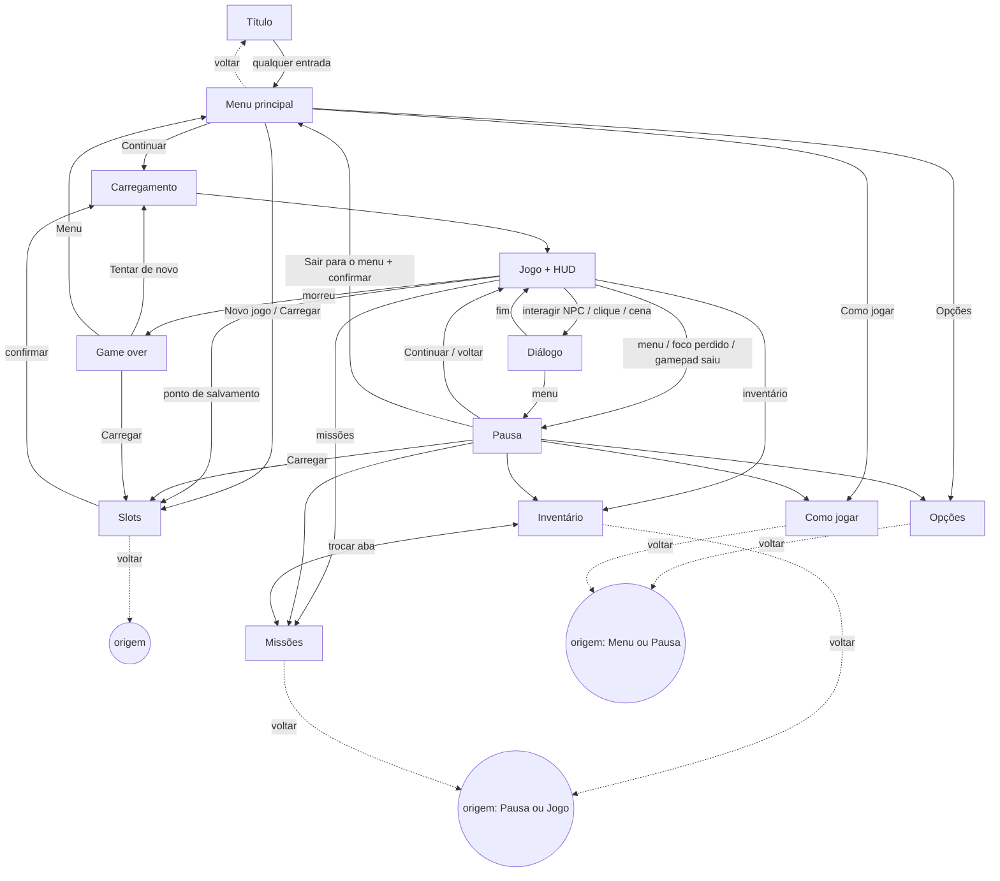

# Inventário de telas, fluxos e HUD — vertical slice

> **Dono:** 07 Cenários e UI · **Versão:** v0.3 (v0.1 restaurada + D-025: visão isométrica e jogo com mouse) · **Data:** 2026-10-24
> Sem arte e sem stack. Moldura, fonte e ícones: guia visual do 10 (**UI de pergaminho/madeira escura**, rampa `ui_*`); implementação: 03/08.
> **O que mudou na v0.3 (só isto):** (1) HUD e zona de ação pensados para a **câmera isométrica** (o herói fica no centro; oclusão); (2) **jogo com mouse**: cursor, alvo sob o cursor (nome e vida), ícones de habilidade clicáveis, marcador de destino; (3) nada mais: telas, fluxos, textos e regras da v0.1 continuam (D-025).
> Controles e acessibilidade: [controles_acessibilidade.md](controles_acessibilidade.md).

## 1. Regras que valem para todas as telas

| # | Regra |
|---|---|
| R1 | Todo texto vem de tabela por ID (`ui_` interface, `txt_` conteúdo do 02). Nada escrito no código, nada montado por concatenação: variáveis inteiras (`{nome_item}`, `{qtd}`, `{tempo_jogo}`). |
| R2 | Todo elemento com texto reserva **+40 %** de largura sobre o texto em português. |
| R3 | Toda tela tem **voltar/cancelar** (teclado, mouse, gamepad), exceto Título e HUD. Confirmação destrutiva abre com foco em "Cancelar". |
| R4 | Grade em múltiplos de 8 px, margem segura de 16 px, escala inteira (§4.2 do 07). |
| R5 | Componentes únicos: botão, lista, grade de itens, barra, ícone, dica, aba, deslizante, alternância, janela. Estados: normal, foco, pressionado, desativado, erro. Foco sempre visível por **forma + cor**. |
| R6 | Animação ≤ 150 ms; com "reduzir movimento", instantânea. |
| R7 | **Barra de comandos** com selos do último dispositivo usado e da atribuição atual. |
| R8 | Abrir tela a partir do jogo **pausa a simulação**, exceto Diálogo (mundo parado por regra do 03) e HUD. |
| R9 | Sons de UI: IDs `ui_` do 05 (§6). |
| R10 | **Reservas de cor** (guia do 10): magenta `perigo_*` só para aviso de golpe/zona de dano no mundo; **nada de UI em magenta**. Erro de UI e vida baixa: forma + ícone + texto + a rampa **`alerta_ui`** (`#f44d21`, contorno `#780105`; `paleta.json` v0.2). Dourado `brilho_*`: foco da UI e interativos (a UI conta como interativo). |
| R11 | **Clique em elemento de UI nunca gera ação de jogo** (não ataca, não anda): a UI "captura" o clique antes do mundo. |

## 2. Telas do slice

"Entradas" = de onde se chega; "Saídas" = para onde se vai; voltar segue R3.

### 2.1 `ui_tela_titulo` — Título "Pressione para começar"
- **Propósito:** apresentar o jogo e obter o **primeiro gesto** (libera o áudio).
- **Conteúdo:** logotipo (10), `ui_titulo_pressione`, versão (`ui_titulo_versao` com `{versao}`), aviso de fotossensibilidade na 1ª execução. **Fundo:** a praça de Baixo Orvalho em vista isométrica, com a luz animada (parada com "reduzir movimento").
- **Entradas:** abrir a página; "Sair para o título". **Saídas:** qualquer tecla, clique ou botão → `ui_tela_menu_principal`.
- **Estados:** carregando (`ui_carregando`), pronto, erro (`ui_erro_carregar`, `ui_tentar_novamente`).

### 2.2 `ui_tela_menu_principal` — Menu principal
- **Opções:** `ui_menu_continuar` (mais recente; desativado sem save), `ui_menu_novo_jogo`, `ui_menu_carregar`, `ui_menu_opcoes`, `ui_menu_como_jogar`.
- **Saídas:** Continuar → Carregamento → Jogo · Novo jogo → `ui_tela_slots` (novo) · Carregar → `ui_tela_slots` · Opções · Como jogar. **Voltar:** Título. Sem "Sair do jogo" (navegador).

### 2.3 `ui_tela_slots` — Slots de save (3 manuais + 1 automático)
- **Modos:** `novo`, `carregar`, `salvar` (pelo ponto de salvamento). Cada slot: `{nome_area}`, `{objetivo}`, `{tempo_jogo}`, `{data}`; vazio `ui_slot_vazio`; automático `ui_slot_automatico` (não sobrescreve nem apaga).
- **Ações:** confirmar, `ui_slot_exportar`, `ui_slot_apagar`, `ui_slot_importar` (validar → escolher slot). Modal `ui_modal_confirmar` (foco em Cancelar).
- **Erros:** `ui_slot_corrompido` (+ `ui_slot_restaurar_backup`), `ui_slot_migrado`, `ui_importar_invalido` (**sem** exibir o conteúdo do arquivo), `ui_aviso_armazenamento_cheio`, salvando (não fechar).
- **Entradas:** menu (novo/carregar), pausa (carregar), ponto de salvamento (salvar), game over (carregar). **Saídas:** carregar/novo → Carregamento → Jogo · salvar → Jogo · voltar → origem.
- **Salvar:** só em pontos de salvamento + automático; a pausa só carrega (D-007).

### 2.4 `ui_tela_opcoes` — Opções
- **Abas (`ui_aba_*`):** **Vídeo** (perfil Alto/Médio/Baixo, tela cheia, tamanho da UI), **Áudio** (por canal), **Controles** (dispositivo, remapear 2 atribuições por ação, botões do mouse, segurar/alternar, zona morta, restaurar padrão; §5 do controles), **Acessibilidade** (itens do checklist que são opção: tremor, flashes, partículas, desfoque, reduzir movimento, daltonismo, tamanho do texto, cursor grande, silhueta de oclusão, legendas, indicador de som, tolerância do cursor, travar alvo, objetivo no HUD).
- Mudanças valem na hora; "restaurar padrão" por aba com confirmação; configurações separadas do save. **Entradas:** menu, pausa. **Saídas:** voltar.

### 2.5 `ui_tela_como_jogar` — Como jogar
- Ações com as atribuições **atuais** do dispositivo em uso; **demonstração do clique** (mover, atacar, interagir; o cursor muda de forma) e 4–6 dicas (`ui_dica_*`). Repetível. **Entradas:** menu, pausa.

### 2.6 `ui_tela_pausa` — Pausa
- **Opções:** `ui_pausa_continuar`, `ui_pausa_inventario`, `ui_pausa_missoes`, `ui_pausa_opcoes`, `ui_pausa_como_jogar`, `ui_pausa_carregar`, `ui_pausa_sair_menu` (confirmação com `{data}` do último salvamento).
- **Sempre visível:** objetivo atual e `{nome_area}`.
- **Entradas:** tecla de menu; **automática** ao perder foco, trocar de aba, sair da tela cheia ou desconectar o gamepad (`ui_pausa_motivo_*`). **O cursor do jogo vira cursor de menu.**

### 2.7 `ui_tela_inventario` — Inventário simples
- Grade com filtros (todos / consumíveis / missão), detalhe do item (`txt_item_*`), `ui_inv_usar`, `ui_inv_definir_rapido` (**também arrastar para o ícone do item rápido no HUD**), ordenar; itens de missão não usáveis nem descartáveis; raridade (se o 06 definir): cor **+ moldura/forma**.
- **Estados:** vazio (`ui_inv_vazio`), selecionado, indisponível. **Entradas:** pausa, atalho `inventario`. **Saídas:** voltar; aba → Missões.

### 2.8 `ui_tela_missoes` — Missões (diário)
- Abas ativas/concluídas; lista com marca principal/secundária por **ícone + texto**; detalhe com objetivo atual em destaque e passos concluídos com ícone; `ui_missoes_acompanhar`; marca "novo". **Entradas:** pausa, atalho `missoes`, notificação de missão nova.

### 2.9 `ui_tela_dialogo` — Diálogo
- Caixa no terço inferior (fora da zona de ação), retrato opcional (04), nome do falante, texto (`txt_dlg_*`) **≤ ~140 caracteres**, indicador "continuar" com o selo de `interagir`, **≤ 3–4 opções**, histórico (`ui_dlg_historico`), pular (escolhas nunca são puladas). Velocidade ajustável; fundo opaco opcional.
- **Com mouse:** clicar em qualquer ponto da caixa avança (primeiro clique completa a linha); escolhas clicáveis. **Entradas:** interagir (tecla **ou clique no NPC/objeto**), cena. **Saídas:** fim → Jogo; menu → Pausa.

### 2.10 `ui_tela_game_over` — Game over
- `ui_gameover_titulo`, dica (`ui_dica_*`); `ui_gameover_tentar` (último autosave/ponto — D-007), `ui_gameover_carregar`, `ui_gameover_menu`. Foco inicial em "Tentar de novo". Sem "voltar".

### 2.11 `ui_tela_carregamento` — Carregamento
- Barra + **porcentagem em texto** (`ui_carregando_pct`), dica. Erros: `ui_erro_carregar` + `ui_tentar_novamente` / `ui_gameover_menu`.

### 2.12 Avisos e modais
| ID | Quando | Ações |
|---|---|---|
| `ui_modal_confirmar` | sobrescrever, apagar, importar, sair, restaurar | Confirmar / Cancelar (foco em Cancelar) |
| `ui_aviso_foco_perdido` | aba/janela sem foco | qualquer entrada → Pausa |
| `ui_aviso_armazenamento_cheio` | falha de escrita | exportar agora / tentar de novo / cancelar |
| `ui_aviso_salvando` | escrita em andamento | ícone no canto |
| `ui_aviso_gamepad_desconectado` | gamepad sai | abre a Pausa |
| `ui_aviso_conflito_tecla` | remapear em conflito | Trocar / Cancelar |
| `ui_aviso_ctrl_navegador` | atribuir Ctrl | Cancelar / Aceitar (com aviso do navegador) |

## 3. HUD

### 3.1 Zonas e câmera isométrica

```
+--------------------------------------------------------------+
| [A] vida / recurso / estados          [B] objetivo atual      |
|                  [F] vida do chefe (faixa superior)           |
|                                                               |
|             +---------------------------+                     |
|             |      ZONA DE AÇÃO         |   [T] alvo sob o    |
|             |  60 % × 60 %, centro no   |   cursor (nome e    |
|             |  herói: nenhum HUD aqui   |   vida) — borda    |
|             +---------------------------+   superior-direita  |
|                                                               |
| [E] notificações           [D] dica de interação               |
| [C] habilidades + item rápido (clicáveis)     [G] salvando    |
+--------------------------------------------------------------+
        margem segura de 16 px em todas as bordas
```

- **Câmera isométrica fixa:** o herói fica **no centro da tela** (a câmera o segue com suavização), então a zona de ação é fixa no centro. Em corredores/limites do mapa a câmera trava e o herói sai do centro: a zona de ação **acompanha o herói**, não a tela.
- **Regra do telegraph (obrigatória):** nenhum elemento do HUD, notificação, número de dano, marcador de destino ou cursor é desenhado **por cima** do aviso de golpe; o aviso é desenhado **depois** da névoa e **acima** do chão, abaixo dos personagens. Se um objeto alto da cena cobrir um aviso, o objeto fica translúcido (A80), nunca o aviso.
- **Oclusão do herói:** se o herói ou um inimigo em combate ficar atrás de algo, aparece a **silhueta de oclusão** (contorno claro) e o objeto fica translúcido; nada do HUD substitui isso.
- **Alvos fora da tela:** no slice não há indicador de inimigos fora da tela por padrão; o indicador de som importante (A21) cobre o caso.

### 3.2 Elementos, estado lido e regras

Nomes de campos/eventos **provisórios** (03 define, 08 formata).

| Zona | Elemento | Mostra | Lê do estado / evento | Regras |
|---|---|---|---|---|
| A | Vida | barra + número `{atual}/{max}` (opção) | `heroi.vida`, `vida_max`; `dano`, `curou` | Vida baixa (≤ 25 %, 06): ícone de alerta **+ forma** da barra + som `ui_vida_baixa`, rampa `alerta_ui`; nunca só cor, nunca magenta. |
| A | Recurso (mana/fôlego — nome do 06) | barra | `heroi.recurso`, `recurso_max`; `recurso_mudou` | Forma/textura diferente da vida. Se houver 2 recursos, 2 barras. |
| A | Estados | ícones com tempo restante | `heroi.estados[]`; `estado_aplicado`, `estado_removido` | Ícone com forma própria + borda boa/ruim por forma; máx. 6, depois "+{qtd}". |
| B | Objetivo atual | 1 linha | `missoes.acompanhada.objetivo_atual`; `missao_mudou` | Ligado por padrão; ≤ 2 linhas; +40 %. |
| C | **Habilidades 1–3 e item rápido — clicáveis** | ícone, selo da tecla/botão atual, recarga | `heroi.habilidades[i]`, `heroi.item_rapido`; `habilidade_usada`, `item_usado` | Recarga: preenchimento radial **+ número**; sem recurso: esmaecida **+ marca**; **o clique no ícone usa a habilidade na direção do cursor** (A37); clique em UI não vira ataque (R11). |
| D | Dica de interação | `[selo] ui_interagir_{tipo}` | `heroi.alvo_interacao` | Some em combate; **com o cursor sobre o alvo, mostra a dica ao lado do cursor** em vez do canto. |
| T | **Alvo sob o cursor (novo)** | nome (`txt_enemy_*_nome`) + barra de vida do inimigo + estado (ícones) | `cursor.alvo` (id, vida, estados) | Aparece só com o cursor sobre inimigo; **contorno do inimigo no mundo** (forma) em vez de só cor; some em 0,3 s depois que o cursor sai. Barra do chefe (F) tem prioridade. |
| E | Notificações | missão nova, item, objetivo | `missao_mudou`, `item_obtido` | Fila até 3; 3 s; sem bloquear. |
| F | Vida do chefe | nome + barra + marcas de fase | `chefe.vida`, `chefe.fases[]`; `chefe_entrou`, `chefe_fase`, `morreu` | Altura ≤ 8 %; fora da zona de ação. |
| G | Salvando | ícone + texto | `save_*` | Falha abre `ui_aviso_armazenamento_cheio`. |
| — | **Cursor (novo)** | seta/espada/mão/✕ conforme o alvo | `cursor.alvo.tipo` | Forma muda (A12); tamanho ≥ 32 px, opção "cursor grande"; sem mouse, some. |
| — | **Marcador de destino (novo)** | anel suave no chão no ponto clicado | `heroi.destino` | **Não magenta**; some ao chegar; abaixo de personagens e do telegraph. |
| — | Números de dano | valor flutuante | `dano`, `curou` | Opção desligar/reduzir; nunca cobrem o aviso de golpe. |
| — | Indicador de som, legendas | borda / terço inferior | eventos de som "importante", `fala` | Opção (A20/A21). |

### 3.3 Visibilidade
- **Fora de combate:** `ui_opt_hud_esconder` (desligada por padrão): A e C somem após 3 s e voltam em qualquer evento de combate; B, D e F seguem as próprias regras; C **volta quando o cursor chega perto do canto** (para o clique).
- **Diálogo e cenas:** HUD some, exceto G.
- **Tamanho:** HUD segue o tamanho da UI; se não couber fora da zona de ação, a zona de ação tem prioridade e o HUD compacta.

## 4. Fluxograma de navegação



### 4.1 Navegação por dispositivo (todas as telas)

| Comando | Teclado | Mouse | Gamepad |
|---|---|---|---|
| Mover foco | setas / WASD | passar o cursor (foco segue o mouse) | analógico esq. / direcional |
| `confirmar` | Enter / Espaço | clique esquerdo | face sul |
| `cancelar` | Esc / Backspace | botão "Voltar"; clique direito | face leste |
| `aba_anterior` / `aba_proxima` | Q / E | clique na aba | ombros |
| `acao_2` / `acao_3` | F / R | botão visível | face oeste / norte |
| Rolar lista | Page Up / Down | roda do mouse | analógico dir. |
| Fechar tudo | tecla de menu | — | Start |

- **Foco inicial** no item mais provável; memória de foco ao voltar.
- **Esc em tela cheia** sai da tela cheia no navegador: sair da tela cheia **abre a Pausa**; `cancelar` tem também Backspace.

## 5. Fora do slice
Mapa e viagem rápida (minimapa incluso; o indicador na borda vira só som) · habilidades/vocações (D-004) · equipamento e comparação ↑↓ · loja e ferreiro · códice · créditos · idioma (M4) · dificuldade e assistências (D-005) · telemetria · controles de toque.

## 6. Sons de UI pedidos ao 05
`ui_navegar`, `ui_confirmar`, `ui_voltar`, `ui_erro`, `ui_aba`, `ui_abrir_menu`, `ui_fechar_menu`, `ui_vida_baixa`, `ui_missao_nova`, `ui_item_obtido`, `ui_salvo`, `ui_clique_destino` (opcional, curto, desligável), `ui_alvo_marcado`.

## 7. Pedidos a outros agentes (via Produtor)
| Para | Pedido |
|---|---|
| 03 | `cursor.alvo`, `heroi.destino`, regra "o que está sob o cursor manda" e pathfinding do clique; sem combate durante diálogos; raio de acerto do cursor. |
| 10 | Cursor (4 formas), marcador de destino, **silhueta de oclusão**, contorno de alvo, camada do telegraph em relação ao cenário alto; moldura e ícones do HUD. |
| 08 | Técnica de oclusão (recorte/transparência, silhueta), picking do cursor em cena isométrica, orçamento de UI. |
| 04 | Retratos (normal, dano, vida baixa) e ícones de item e de habilidade. |

## 8. IDs de texto desta versão
Todos os `ui_*` citados entram na tabela de textos; `txt_*` vêm do 02. Pendente: arquivo da tabela no formato do 08.
