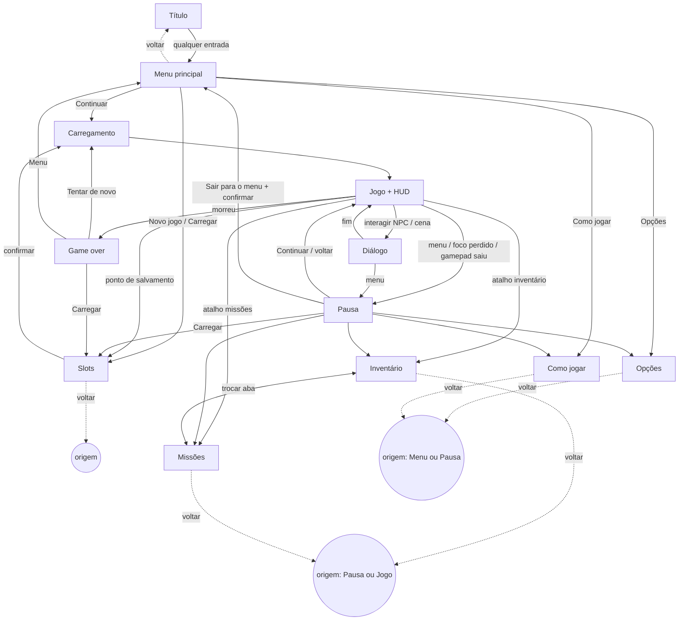

# Inventário de telas, fluxos e HUD — vertical slice

> **Dono:** 07 Cenários e UI · **Versão:** v0.1 (rascunho, BRF-005) · **Data:** 2026-10-24
> Sem arte e sem stack. Moldura, fonte e ícones ficam para o guia visual (10); implementação é do 03.
> Controles e acessibilidade: [controles_acessibilidade.md](controles_acessibilidade.md).

## 1. Regras que valem para todas as telas

| # | Regra |
|---|---|
| R1 | Todo texto vem de tabela por ID (`ui_` para interface, `txt_` para conteúdo do 02). Nada escrito no código, nada montado por concatenação: variáveis inteiras (`{nome_item}`, `{qtd}`, `{tempo_jogo}`). |
| R2 | Todo elemento com texto reserva **+40 %** de largura sobre o texto em português; quebra de linha prevista onde o texto pode crescer. |
| R3 | Toda tela tem **voltar/cancelar** (teclado, mouse e gamepad), exceto Título e HUD. Telas modais de confirmação têm "Cancelar" como foco inicial em ações destrutivas. |
| R4 | Grade em múltiplos de 8 px, margem segura de 16 px, escala inteira (§4.2 do 07). |
| R5 | Componentes únicos: botão, lista, grade de itens, barra, ícone, dica, aba, deslizante, alternância, janela. Estados: normal, foco, pressionado, desativado, erro. Foco sempre visível por **forma + cor**. |
| R6 | Animações ≤ 150 ms; com "reduzir movimento", transições são instantâneas. |
| R7 | Os comandos da tela ficam sempre visíveis numa **barra de comandos** no rodapé, com ícones do último dispositivo usado (ver controles §4). |
| R8 | Abrir qualquer tela a partir do jogo **pausa a simulação**, exceto Diálogo (o mundo fica parado por regra do 03) e HUD. |
| R9 | Sons de navegação/confirmação/erro usam IDs `ui_` do 05 (lista em §5). |
| R10 | **Reservas de cor** (`docs/arte/guia_visual.md` §4, §8, §9): magenta `perigo_*` é exclusivo do aviso de golpe e zonas de dano no mundo — nenhum elemento de HUD/UI usa magenta (ver pendência P1 em §7). Dourado `brilho_*` só para interativos/coletáveis no mundo e para o **foco** da UI (guia §8). Base da UI: rampa `ui_*` (painel escuro quente, borda, texto secundário, texto). |

## 2. Telas do slice

Convenção: **Entradas** = de onde se chega; **Saídas** = para onde se vai. "Voltar" segue R3.

### 2.1 `ui_tela_titulo` — Título "Pressione para começar"
- **Propósito:** apresentar o jogo e obter o **primeiro gesto do jogador**, que libera o áudio no navegador.
- **Conteúdo:** logotipo (10), `ui_titulo_pressione` ("Pressione qualquer tecla ou botão"), versão do build (`ui_titulo_versao` com `{versao}`), aviso de fotossensibilidade curto (`ui_aviso_fotossensibilidade`) na 1ª execução.
- **Entradas:** abrir a página; "Sair para o título" (pausa, game over).
- **Saídas:** qualquer tecla, clique ou botão → `ui_tela_menu_principal`.
- **Estados:** carregando (indicador + `ui_carregando`), pronto, erro de carregamento (`ui_erro_carregar`, botão `ui_tentar_novamente`).

### 2.2 `ui_tela_menu_principal` — Menu principal
- **Propósito:** começar ou continuar.
- **Opções:** `ui_menu_continuar` (carrega o save mais recente; desativado se não houver save), `ui_menu_novo_jogo`, `ui_menu_carregar`, `ui_menu_opcoes`, `ui_menu_como_jogar`.
- **Entradas:** Título; "Sair para o menu" da pausa e do game over.
- **Saídas:** Continuar → Carregamento → Jogo · Novo jogo → `ui_tela_slots` (modo escolher slot) · Carregar → `ui_tela_slots` (modo carregar) · Opções → `ui_tela_opcoes` · Como jogar → `ui_tela_como_jogar`.
- **Voltar:** volta ao Título.
- **Nota:** sem "Sair do jogo" (no navegador, fechar a aba basta).

### 2.3 `ui_tela_slots` — Slots de save (3 manuais + 1 automático)
- **Propósito:** escolher onde começar, carregar, salvar, exportar e importar.
- **Modos:** `novo` (escolher slot vazio ou sobrescrever), `carregar`, `salvar` (aberto pelo ponto de salvamento).
- **Cada slot mostra:** nome da área (`{nome_area}`), objetivo atual (`{objetivo}`), tempo de jogo (`{tempo_jogo}`), data/hora (`{data}`), nível/progresso se o 06 definir. Slot vazio: `ui_slot_vazio`. Slot automático: `ui_slot_automatico` (não pode ser sobrescrito manualmente nem apagado).
- **Ações por slot:** confirmar (conforme o modo), `ui_slot_exportar` (gera arquivo para baixar), `ui_slot_apagar` (manuais), e na tela: `ui_slot_importar` (escolher arquivo → validar → escolher slot de destino).
- **Confirmações (modal `ui_modal_confirmar`):** sobrescrever, apagar, importar por cima de slot ocupado. Foco inicial em "Cancelar".
- **Estados/erros:** slot corrompido (`ui_slot_corrompido` + oferta de restaurar backup `ui_slot_restaurar_backup`), versão antiga migrada (`ui_slot_migrado`, informativo), importação inválida (`ui_importar_invalido` com motivo genérico, **sem** exibir conteúdo do arquivo), armazenamento cheio (`ui_aviso_armazenamento_cheio`), salvando (indicador; não fechar).
- **Entradas:** menu principal (novo/carregar), pausa (carregar), ponto de salvamento no mundo (salvar), game over (carregar).
- **Saídas:** carregar/novo → Carregamento → Jogo · salvar → volta ao Jogo · voltar → tela de origem.

### 2.4 `ui_tela_opcoes` — Opções
- **Propósito:** ajustar vídeo, áudio, controles e acessibilidade.
- **Abas (`ui_aba_*`):**
  - **Vídeo:** perfil de qualidade (Alto/Médio/Baixo, 08), tela cheia, tamanho da UI (escalas inteiras disponíveis na resolução atual).
  - **Áudio:** volume geral, música, efeitos, ambiente, interface; legendas/indicadores de som (atalho para Acessibilidade).
  - **Controles:** dispositivo (teclado e mouse / gamepad), lista de ações com 2 atribuições, remapear, segurar/alternar, zona morta do analógico, restaurar padrão. Detalhe em controles §5.
  - **Acessibilidade:** itens do checklist de controles §7 que são opções.
- **Comportamento:** mudanças valem na hora (prévia); `ui_opcoes_restaurar_padrao` por aba com confirmação; ao sair, salva automaticamente nas configurações (separadas do save do jogo).
- **Entradas:** menu principal, pausa.
- **Saídas:** voltar → origem.

### 2.5 `ui_tela_como_jogar` — Como jogar
- **Propósito:** tutorial repetível (§4.5/§4.6 do 07): lista das ações com os botões **atuais** (remapeados) do dispositivo em uso, e 4–6 dicas curtas (`ui_dica_*`, texto do 02/03).
- **Entradas:** menu principal, pausa. **Saídas:** voltar → origem.

### 2.6 `ui_tela_pausa` — Pausa
- **Propósito:** parar o jogo a qualquer momento e acessar o resto.
- **Opções:** `ui_pausa_continuar`, `ui_pausa_inventario`, `ui_pausa_missoes`, `ui_pausa_opcoes`, `ui_pausa_como_jogar`, `ui_pausa_carregar`, `ui_pausa_sair_menu` (confirmação: "progresso não salvo será perdido", mostrando o horário do último save `{data}`).
- **Sempre visível:** objetivo atual (`{objetivo}`) e área (`{nome_area}`).
- **Entradas:** tecla/botão de menu durante o jogo; **automática** ao perder o foco, trocar de aba, sair da tela cheia ou desconectar o gamepad (mensagem `ui_pausa_motivo_*`).
- **Saídas:** cada opção → tela correspondente · continuar/voltar → Jogo.

### 2.7 `ui_tela_inventario` — Inventário simples
- **Propósito:** ver e usar itens do slice (cura e itens de missão) e escolher o item rápido.
- **Conteúdo:** grade de itens (ícone, quantidade `{qtd}`, nome `{nome_item}`); painel de detalhe (nome, descrição `txt_item_*_desc`, efeito); filtros `ui_inv_filtro_todos` / `ui_inv_filtro_consumiveis` / `ui_inv_filtro_missao`; indicador do item rápido atual.
- **Ações:** `ui_inv_usar` (consumíveis; desativado se não tem efeito agora, com motivo), `ui_inv_definir_rapido`, ordenar (`ui_inv_ordenar`). Itens de missão não podem ser usados nem descartados.
- **Raridade:** só se o 06 definir para o slice; se existir, cor **+ moldura/forma** (nunca só cor).
- **Estados:** vazio (`ui_inv_vazio`), item selecionado, ação indisponível.
- **Entradas:** pausa; atalho direto durante o jogo. **Saídas:** voltar → origem (pausa ou jogo); trocar de aba (LB/RB, Q/E na tela) → Missões.

### 2.8 `ui_tela_missoes` — Missões (diário)
- **Propósito:** saber o que fazer agora.
- **Conteúdo:** abas `ui_missoes_ativas` / `ui_missoes_concluidas`; lista (nome `txt_quest_*_nome`, marca de principal/secundária por **ícone + texto**); detalhe com descrição, objetivo atual em destaque e passos concluídos riscados **e** marcados com ícone; botão `ui_missoes_acompanhar` (define o objetivo mostrado no HUD).
- **Estados:** sem missões (`ui_missoes_vazio`), missão nova (marca "novo" até ser vista).
- **Entradas:** pausa; atalho direto; notificação de missão nova no HUD (atalho abre a missão). **Saídas:** voltar → origem; trocar de aba → Inventário.

### 2.9 `ui_tela_dialogo` — Diálogo
- **Propósito:** tocar falas e escolhas do 02 (dados de diálogo; flags pelo 03).
- **Conteúdo:** caixa no terço inferior (fora da zona de ação, §4.3), retrato opcional (04), nome do falante (`txt_npc_*_nome`), texto (`txt_dlg_*`) com **≤ ~140 caracteres por caixa**, indicador "continuar", até **3–4 opções** de escolha.
- **Ações:** avançar (completa o texto se ainda escrevendo; depois avança), pular conversa (segurar ou confirmar, com confirmação se houver escolha pendente — escolhas nunca são puladas), `ui_dlg_historico` (falas desta conversa e anteriores da sessão).
- **Opções aplicáveis:** velocidade do texto (lenta/normal/rápida/instantânea), avanço automático (desligado por padrão), fundo da caixa opaco.
- **Entradas:** interagir com NPC/objeto; gatilho de cena (03). **Saídas:** fim da conversa → Jogo; menu/pausa permitido a qualquer momento.

### 2.10 `ui_tela_game_over` — Game over
- **Propósito:** recomeçar rápido.
- **Conteúdo:** `ui_gameover_titulo`, dica curta aleatória (`ui_dica_*`).
- **Opções:** `ui_gameover_tentar` (recarrega o último save automático ou ponto de controle — regra do 06/03), `ui_gameover_carregar` (→ Slots), `ui_gameover_menu` (→ Menu principal).
- **Entradas:** evento `morreu` do herói. **Saídas:** acima. Sem "voltar" (não há para onde voltar); foco inicial em "Tentar de novo".

### 2.11 `ui_tela_carregamento` — Carregamento
- **Propósito:** cobrir carregamento de área e de save.
- **Conteúdo:** barra de progresso **com porcentagem em texto** (`ui_carregando_pct` com `{pct}`), dica (`ui_dica_*`). Sem ações.
- **Erros:** falha ao carregar área → `ui_erro_carregar` + `ui_tentar_novamente` / `ui_gameover_menu`.

### 2.12 Avisos e modais (`ui_aviso_*`, `ui_modal_*`)
| ID | Quando | Ações |
|---|---|---|
| `ui_modal_confirmar` | Sobrescrever, apagar, importar, sair para o menu, restaurar padrões | Confirmar / Cancelar (foco em Cancelar) |
| `ui_aviso_foco_perdido` | Aba em segundo plano / janela sem foco (jogo e áudio pausados, tempo perdido não é simulado) | Qualquer entrada → Pausa |
| `ui_aviso_armazenamento_cheio` | Falha de escrita do save | Exportar save agora / Tentar de novo / Cancelar |
| `ui_aviso_salvando` | Escrita em andamento (ícone no canto, não bloqueia) | — |
| `ui_aviso_gamepad_desconectado` | Gamepad sai durante o jogo | Pausa automática; continuar com teclado ou reconectar |
| `ui_aviso_conflito_tecla` | Remapear para tecla já usada | Trocar / Cancelar (controles §5) |

### 2.13 `ui_hud` — HUD
Ver §4.

## 3. Fluxograma de navegação



### 3.1 Comandos de navegação por dispositivo (em todas as telas)

| Comando | Teclado | Mouse | Gamepad |
|---|---|---|---|
| Mover foco | Setas / WASD | Passar o cursor (o foco segue o mouse) | Analógico esquerdo / direcional |
| `confirmar` | Enter | Clique esquerdo | Face sul |
| `cancelar` (voltar) | Esc / Backspace | Botão "Voltar" visível na tela; clique direito | Face leste |
| `aba_anterior` / `aba_proxima` | Q / E | Clique na aba | Ombro esquerdo / direito |
| `acao_2` (ex.: definir item rápido, exportar) | F | Botão visível | Face oeste |
| `acao_3` (ex.: ordenar, apagar) | R | Botão visível | Face norte |
| Rolar lista longa | Page Up / Page Down | Roda do mouse | Analógico direito |
| Fechar tudo e voltar ao jogo (de tela aberta a partir do jogo) | `menu` (Esc / P) | — | Start |

- **Esc em tela cheia:** o navegador usa Esc para sair da tela cheia. Por isso Backspace também volta, e sair da tela cheia abre a Pausa (nunca perde o jogo). Detalhe e teclas proibidas em controles §3.
- Ícones e rótulos da barra de comandos (R7) mudam para o último dispositivo usado.

### 3.2 Foco inicial e memória de foco
- Cada tela abre com foco no item mais provável (Continuar, primeiro slot ocupado, primeiro item, missão acompanhada) e, em modais destrutivos, em Cancelar.
- Ao voltar a uma tela, o foco volta ao item que a abriu.

## 4. HUD

### 4.1 Zonas da tela

```
+----------------------------------------------------------+
| [A] vida / recurso / estados       [B] objetivo atual     |
|                 [F] vida do chefe (faixa superior)        |
|                                                           |
|            +---------------------------+                  |
|            |      ZONA DE AÇÃO         |                  |
|            |  (60 % L x 60 % A, centro |                  |
|            |   no herói) — sem HUD     |                  |
|            +---------------------------+                  |
|                                                           |
| [E] notificações         [D] dica de interação            |
| [C] habilidades + item rápido     [G] ícone "salvando"   |
+----------------------------------------------------------+
         margem segura de 16 px em todas as bordas
```

**Regra do telegraph (obrigatória):** nenhum elemento do HUD, notificação, número ou efeito de UI é desenhado dentro da **zona de ação** (retângulo de 60 % × 60 % da tela centrado na posição do herói na tela). O aviso de ataque inimigo é desenhado no mundo e **sempre por cima** do HUD se houver sobreposição em telas pequenas. A dica de interação [D] fica no canto e não sobre o alvo; o ícone sobre o alvo no mundo (03) **some** quando há inimigo em combate a menos de 6 tiles (valor em dados, 06/03).

### 4.2 Elementos, fonte de estado e regras

Nomes de campos e eventos são **provisórios** (dono: 03, formato: 08); valem como contrato de "o que a UI precisa ler".

| Zona | Elemento | Mostra | Lê do estado / evento | Regras |
|---|---|---|---|---|
| A | Vida | barra + número `{atual}/{max}` (opção) | `heroi.vida`, `heroi.vida_max`; evento `dano`, `curou` | Vida baixa (≤ 25 %, valor do 06): ícone de alerta **+ forma** da barra muda (contorno pulsando ≤ 2/s, desligável) + som `ui_vida_baixa` (05). Nunca só cor. |
| A | Recurso (mana/fôlego — nome do 06) | barra | `heroi.recurso`, `heroi.recurso_max`; evento `recurso_mudou` | Barra com textura/forma diferente da vida (não só cor). Se o 06 tiver 2 recursos, mesma zona, 2 barras. |
| A | Estados (efeitos) | ícones com tempo restante | `heroi.estados[]` (id, restante); eventos `estado_aplicado`, `estado_removido` | Cada estado: ícone com forma própria + borda boa/ruim por forma; máx. 6 visíveis, depois "+{qtd}". |
| B | Objetivo atual | 1 linha (`txt_quest_*_obj`) | `missoes.acompanhada.objetivo_atual`; evento `missao_mudou` | Opção ligada por padrão (acessibilidade cognitiva). Quebra em 2 linhas no máximo; +40 %. |
| C | Habilidades 1–3 | ícone, botão atual, recarga | `heroi.habilidades[i]` (id, recarga_restante, custo, disponivel); evento `habilidade_usada` | Recarga: preenchimento radial **+ número de segundos** (opção). Sem recurso: ícone esmaecido **+ marca**. Botão mostrado conforme dispositivo e remapeamento. |
| C | Item rápido | ícone, quantidade | `heroi.item_rapido` (id, qtd); evento `item_usado`, `inventario_mudou` | Quantidade 0: marca de vazio. |
| D | Dica de interação | "[botão] `ui_interagir_{tipo}`" (Falar, Abrir, Ler, Salvar…) | `heroi.alvo_interacao` (tipo, id) | Some em combate (ver 4.1). |
| E | Notificações | "Missão nova", "Objetivo concluído", "Item obtido `{nome_item}` ×`{qtd}`" | eventos `missao_mudou`, `item_obtido` | Fila, até 3 visíveis, 3 s cada (dados), sem bloquear entrada; com "reduzir movimento", entram sem deslizar. |
| F | Vida do chefe | nome (`txt_boss_*_nome`) + barra + marcas de fase | `chefe.vida`, `chefe.vida_max`, `chefe.fases[]`; eventos `chefe_entrou`, `chefe_fase`, `morreu` | Faixa superior dentro da margem; altura ≤ 8 % da tela; nunca entra na zona de ação. Só aparece com chefe ativo. |
| G | Salvando | ícone animado + `ui_aviso_salvando` | evento `save_iniciou` / `save_terminou` / `save_falhou` | Falha abre `ui_aviso_armazenamento_cheio` (ou erro genérico) na próxima pausa segura. |
| — | Indicadores de som (acessibilidade) | seta/ícone na borda na direção da fonte | eventos de som marcados "importante" pelo 05 (ataque fora da tela, inimigo se aproximando) | Só com a opção ligada; ficam na borda, fora da zona de ação. |
| — | Legendas | falas e sons ambientes importantes | eventos `fala` (02/05) | Terço inferior, fundo opaco; não usadas em diálogo de caixa (já é texto). |

### 4.3 Visibilidade
- **Fora de combate:** opção `ui_opt_hud_esconder_fora_combate` (desligada por padrão). Quando ligada, A e C somem após 3 s sem combate/dano/mudança e voltam na hora com qualquer evento de combate. B, D e F seguem as próprias regras.
- **Diálogo e cenas:** HUD some, exceto G.
- **Pausa e telas:** HUD escondido atrás da tela aberta.
- **Tamanho:** HUD segue o tamanho da UI; em escala maior, se não couber fora da zona de ação, a zona de ação tem prioridade e o HUD compacta (oculta números, mantém barras).

## 5. Sons de UI pedidos ao 05 (via Produtor)
`ui_navegar`, `ui_confirmar`, `ui_voltar`, `ui_erro`, `ui_aba`, `ui_abrir_menu`, `ui_fechar_menu`, `ui_vida_baixa`, `ui_missao_nova`, `ui_item_obtido`, `ui_salvo`.

## 6. Fora do slice (não desenhar agora)
| Tela / elemento | Motivo | Quando reavaliar |
|---|---|---|
| Mapa e viagem rápida (inclui minimapa) | Não está no escopo DENTRO da Bíblia | M4 (ou antes, se o 06 achar que a região aberta exige) |
| Habilidades / vocações (árvore, redistribuir pontos) | D-004: kit fixo, sem vocações | P2, após M3 |
| Equipamento e comparação ↑↓ | Slice tem "inventário simples" (itens de cura) | Quando houver equipamento |
| Loja e ferreiro | Sem economia no escopo | Pós-slice |
| Códice de lore | Depende do mundo (02) e não está no escopo | M4 |
| Créditos | Não é necessário para validar o slice | M4 (lançamento) |
| Seleção de idioma | Slice só em português do Brasil | M4 (inglês) |
| Seleção de dificuldade e assistências | D-005: só Normal | M4 |
| Privacidade / telemetria | Depende de o 08 incluir telemetria | Quando o 08 decidir |
| Controles por toque | Celular fora do escopo | Pós-slice |

## 7. Decisões de cor (resolvidas pelo Produtor)
- **P1 (aceita):** magenta é 100 % "golpe vindo no mundo". Erro de UI e vida baixa no HUD usam forma + ícone + texto + a rampa **`alerta_ui`** do 10 (`paleta.json` v0.2: `#f44d21`, contorno `#780105`, 5,1:1 no painel). A18 fechado.
- **P2 (aceita):** o foco da UI em `brilho_*` vale; a UI conta como interativo.

## 8. Lista de IDs de texto desta versão
Todos os `ui_*` citados acima entram na tabela de textos do 01/02. Conteúdo (`txt_*`) vem dos dados do 02. Pendente: arquivo da tabela no formato do 08.
